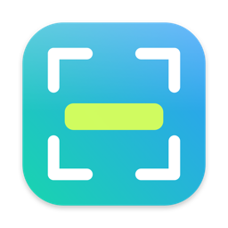

<p align="center">
  
</p>

<h1 align="center">Snip</h1>

<p align="center">A small screenshot and screen-recording app for macOS, in the spirit of the Windows Snipping Tool.</p>

Press a shortcut, drag over the part of the screen you want, and the capture is saved to disk and copied to your clipboard. Open the app to browse past captures, draw on them, or play back recordings.

## What it does

- **Screenshots.** Select an area, or grab the whole display under your mouse. Plays a shutter sound (can be turned off).
- **Screen recordings.** Record an area or the full screen to `.mp4`, with pause and resume. A small control bar floats on screen while you record; it isn't captured in the video.
- **Editor.** Pen, highlighter, eraser, colors, line width, undo/redo, copy, save and delete.
- **Gallery.** All your screenshots and recordings in one window.
- **Settings.** Rebind every shortcut and switch sounds on or off (**⌘,**).

Captures are saved to `~/Pictures/Screenshots/`.

## Shortcuts

| Action | Default |
| --- | --- |
| Screenshot (select an area) | **⌃⇧S** |
| Full-screen screenshot | **⌃⌥⇧S** |
| Record (select an area) | **⌃⇧R** |
| Full-screen recording | **⌃⌥⇧R** |

Press **Esc** to cancel a selection. Press the recording shortcut again, or click the red menu-bar icon, to stop recording.

## Install

You need macOS 15 (Sequoia) or later and the Xcode Command Line Tools (`xcode-select --install`).

```sh
git clone https://github.com/CCliff8/Screenshot-app.git
cd Screenshot-app
./install.sh
```

This builds the app, copies it to `/Applications` and launches it, so Spotlight and Raycast can find it. If you only want a local build, run `./build.sh` and then `open Snip.app`.

## Permissions

The first time you capture, macOS asks for Screen Recording access. Allow it under **System Settings → Privacy & Security → Screen & System Audio Recording**, then quit and reopen Snip.

The app is signed locally, so macOS sees every rebuild as a new app and may ask again. If that happens, remove Snip from the list, add it back and restart it. To stop this from recurring, run `scripts/make_cert.sh` once to create a local signing certificate; `build.sh` uses it automatically.

## Project layout

```
Sources/Snip/   Swift code (AppKit, SwiftUI, ScreenCaptureKit)
Resources/      App icon and logo
scripts/        Icon generator and local signing helper
build.sh        Builds Snip.app
install.sh      Builds and installs to /Applications
```

## License

[MIT](LICENSE)
